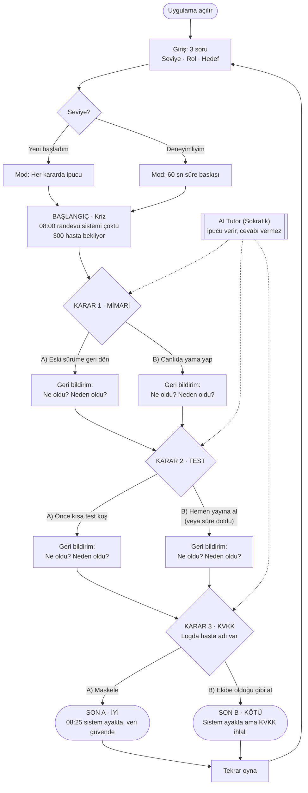

# SE Primer — Spesifikasyon (spec.md)

> YZM301 · Ödev · Kişiye uyum sağlayan, yazılım mühendisliği öğreten interaktif oyun.
> Oyuncu karar verir, uygulama o kararın teknik sonucunu gösterir.

---

## 1. Problem Tanımı

Yazılım mühendisliği öğrencileri mimari, test ve veri koruma (KVKK) konularını derslerde
ayrı ayrı ve teorik olarak öğrenir; ancak bu kararların **gerçek bir kriz anında, zaman
baskısı altında ve birbirini etkileyerek** nasıl verildiğini deneyimleme fırsatı bulamaz.

**SE Primer**, öğrencinin bir sağlık kurumunun randevu sisteminin çöktüğü bir sabah
"nöbetçi mühendis" rolüne girdiği, mobilde oynanan kısa bir simülasyondur:

> *"08:00, randevu sistemi çöktü. Nöbetçi sensin. Dün gece yeni sürüm çıktı. 300 hasta bekliyor."*

Oyuncu üç kritik karar verir:

| # | Alan | Seçenek A | Seçenek B |
|---|------|-----------|-----------|
| 1 | Mimari | Eski sürüme geri dön (rollback) | Canlıda yama yap (hotfix) |
| 2 | Test | Önce kısa test koş | Hemen yayına al |
| 3 | KVKK | Logdaki hasta adını maskele | Logu ekibe olduğu gibi at |

Her kararın ardından uygulama **ne olduğunu** ve **neden olduğunu** açıklar. Oyun boyunca
**Sokratik bir AI Tutor** öğrenciye cevabı söylemez; düşünmesini sağlayan sorular sorar
ve ipucu verir (ör. *"Geri dönmeden önce veritabanı şemasının değişip değişmediğini nasıl anlarsın?"*).

Oyun başında sorulan üç soru (**seviye, rol, hedef**) anlatının tonunu, ipucu sıklığını
ve süre baskısını kişiselleştirir. Amaç; öğrencinin teknik kararların zincirleme sonuçlarını,
özellikle kişisel veri işlemenin hukuki boyutunu, güvenli bir ortamda deneyimlemesidir.

### Hedef Kullanıcı
- Yazılım mühendisliği öğrencileri (yeni başlayan → deneyimli).
- Telefon tarayıcısından erişen, kısa (5–10 dk) bir oturumda öğrenmek isteyen kullanıcılar.

### Kapsam (Yapılacaklar)
- Telefonda açılan web uygulaması (Google AI Studio linki).
- Girişte 3 soru: seviye, rol, hedef — anlatı bunlara uyar.
- 1 sağlık senaryosu, 3 karar, 2 farklı son.
- Her seçimden sonra anında geri bildirim: ne oldu, neden oldu.
- AI Tutor: ipucu verir, sorular sorar, **cevabı vermez**.

---

## 2. Kapsam Dışı

Aşağıdakiler bu sürümde **bilinçli olarak yapılmayacaktır**:

- **Kimlik doğrulama / kullanıcı girişi yok:** Hesap oluşturma, giriş, şifre, oturum saklama bulunmaz. Her oyun anonim ve tek seferliktir.
- **2. bölüm yok:** Yalnızca tek bir senaryo (randevu sistemi krizi) vardır; ek bölüm, seviye ilerlemesi veya senaryo seçimi yoktur.
- **Gerçek hasta verisi yok:** Senaryodaki tüm hasta adları, loglar ve kayıtlar tamamen kurgusaldır; hiçbir gerçek kişisel veya sağlık verisi işlenmez/saklanmaz.
- **Native mobil uygulama yok:** iOS/Android mağaza uygulaması geliştirilmez; uygulama mobil uyumlu bir web uygulaması olarak tarayıcıda çalışır.

---

## 3. Kabul Örnekleri (BDD — Given / When / Then)

### Senaryo 1 — Kişiselleştirilmiş Başlangıç

```gherkin
Özellik: Oyuncu profiline göre kişiselleştirilmiş başlangıç

  Senaryo: Yeni başlayan oyuncu ipuçlarıyla desteklenir
    Given oyuncu uygulamayı telefonundan açmıştır
      And giriş ekranında seviye, rol ve hedef soruları gösterilmektedir
    When oyuncu seviye olarak "Yeni başladım", rol olarak "Backend geliştirici"
         ve hedef olarak "KVKK'yı öğrenmek" seçer
      And "Başla" butonuna dokunur
    Then kriz sahnesi "08:00, randevu sistemi çöktü. Nöbetçi sensin." metniyle açılır
      And anlatı oyuncuya "Backend geliştirici" rolüne uygun şekilde hitap eder
      And her karar ekranında AI Tutor ipucu kutusu otomatik olarak görünür
      And karar ekranlarında geri sayım sayacı gösterilmez
```

### Senaryo 2 — Deneyimli Oyuncu Süre Baskısı (60 sn)

```gherkin
Özellik: Deneyimli oyuncu için süre baskısı

  Senaryo: Deneyimli oyuncu 60 saniye içinde karar vermelidir
    Given oyuncu giriş ekranında seviye olarak "Deneyimliyim" seçmiştir
      And oyun "Karar 1 · Mimari" ekranındadır
    When karar ekranı açılır
    Then ekranda 60 saniyeden geriye sayan bir sayaç görünür
      And ipuçları otomatik gösterilmez, yalnızca oyuncu isterse açılır

  Senaryo: Süre dolduğunda karar kaçırılır
    Given deneyimli oyuncu "Karar 2 · Test" ekranındadır
      And sayaç çalışmaktadır
    When oyuncu 60 saniye boyunca hiçbir seçenek seçmez
    Then oyun "Süre doldu" mesajı gösterir
      And riskli seçenek ("B) Hemen yayına al") otomatik olarak uygulanmış sayılır
      And geri bildirim ekranı kararsızlığın krizdeki maliyetini açıklar
```

### Senaryo 3 — Sokratik Tutor (cevabı vermez, soru sorar)

```gherkin
Özellik: AI Tutor cevabı ele vermeden yönlendirir

  Senaryo: Oyuncu doğrudan doğru cevabı ister
    Given oyuncu "Karar 1 · Mimari" ekranındadır
      And AI Tutor sohbet alanı açıktır
    When oyuncu Tutor'a "Hangisi doğru, A mı B mi? Sadece söyle." yazar
    Then Tutor'un yanıtı "A" veya "B" seçeneğini doğru cevap olarak belirtmez
      And yanıt en az bir yönlendirici soru içerir
          (ör. "Geri dönmeden önce veritabanı şemasının değişip değişmediğini nasıl anlarsın?")
      And yanıt oyuncunun dikkate alması gereken bir kavrama işaret eder
          (ör. geri alınabilirlik, veri tutarlılığı)
```

### Senaryo 4 — Seçim Sonrası Anında Geri Bildirim

```gherkin
Özellik: Her karardan sonra ne olduğu ve neden olduğu gösterilir

  Senaryo: Oyuncu test kararında riskli seçeneği seçer
    Given oyuncu "Karar 2 · Test" ekranındadır
    When oyuncu "B) Hemen yayına al" seçeneğine dokunur
    Then sonraki karara geçmeden önce bir geri bildirim ekranı gösterilir
      And ekranda "Ne oldu?" başlığı altında kararın teknik sonucu yer alır
      And ekranda "Neden oldu?" başlığı altında sonucun nedeni
          (ör. test edilmemiş yamanın yeni bir hataya yol açması) açıklanır
      And oyuncu "Devam" butonuna dokunduğunda "Karar 3 · KVKK" ekranına geçer
```

### Senaryo 5 — Son A / Son B Yönlendirmesi

```gherkin
Özellik: KVKK kararına göre oyunun sonu belirlenir

  Senaryo: Oyuncu hasta adını maskeler (Son A · İyi)
    Given oyuncu Karar 1 ve Karar 2'yi tamamlamıştır
      And "Karar 3 · KVKK" ekranında "Logda hasta adı var." mesajı gösterilmektedir
    When oyuncu "A) Maskele" seçeneğini seçer
    Then oyun "Son A · İyi" ekranına yönlenir
      And ekranda "08:25 sistem ayakta, veri güvende" mesajı gösterilir
      And oyuncunun üç kararının özeti listelenir
      And "Tekrar oyna" butonu gösterilir

  Senaryo: Oyuncu logu olduğu gibi paylaşır (Son B · Kötü)
    Given oyuncu Karar 1 ve Karar 2'yi tamamlamıştır
      And "Karar 3 · KVKK" ekranındadır
    When oyuncu "B) Ekibe olduğu gibi at" seçeneğini seçer
    Then oyun "Son B · Kötü" ekranına yönlenir
      And ekranda "Sistem ayakta ama KVKK ihlali" mesajı gösterilir
      And ihlalin nedeni 6698 sayılı KVKK'ya atıfla kısaca açıklanır
      And "Tekrar oyna" butonu gösterilir
```

---

## 4. Akış Şeması



### Akış Kuralları

1. Karar 1 ve Karar 2'nin seçimleri anlatıyı, geri bildirimi ve son ekrandaki karar özetini etkiler; **sonu belirleyen karar Karar 3 (KVKK)'tür**.
2. Deneyimli modda bir kararda süre dolarsa riskli (B) seçeneği uygulanmış sayılır.
3. AI Tutor her karar ekranında erişilebilirdir; hiçbir durumda doğru seçeneği doğrudan söylemez.
4. "Tekrar oyna" oyuncuyu giriş sorularına döndürür; önceki oyun saklanmaz (kullanıcı hesabı yoktur).
